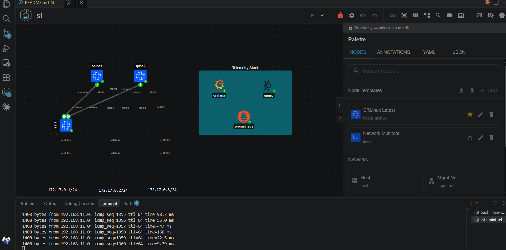
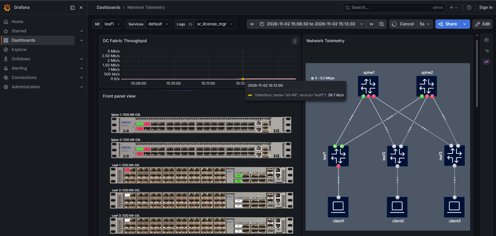
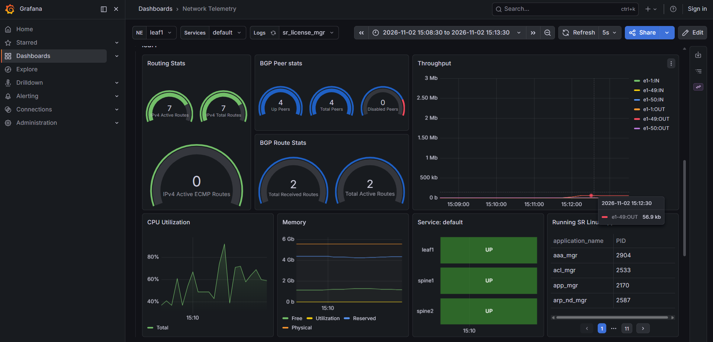

# Network Automation Lab: Containerlab, Python and Streaming Telemetry

A virtual network built with Containerlab and Nokia SR Linux, configured with Python automation and monitored in real time with gNMIc, Prometheus and Grafana.

Author: [Samson M'mbasu Mukhwana] | [Attachee] 

## Overview

The project covers a full automation loop:

1. **Describe** the network as code (Containerlab topology in YAML)
2. **Configure** devices with Python (Netmiko), with data in YAML and commands in Jinja2 templates
3. **Monitor** with streaming telemetry (gNMIc, Prometheus, Grafana)
4. **Verify** that automated changes show up on the dashboard

## Topology

- 2 spine routers (`spine1`, `spine2`) and 1 leaf router (`leaf1`), Nokia SR Linux 25.10
- Each spine links to the leaf (`leaf1` e1-49 to `spine1`, e1-50 to `spine2`)
- Telemetry stack: gNMIc (collector), Prometheus (storage), Grafana (dashboards)



## Repository contents

| Path | Purpose |
|---|---|
| `st.clab.yml` | Containerlab topology |
| `configs/fabric/` | Router startup configurations |
| `configs/gnmic/` | gNMIc targets and subscriptions |
| `configs/prometheus/`, `configs/grafana/` | Metrics storage and dashboards |
| `automation/toggle_interface.py` | Takes an interface down and up again |

## Requirements

- Windows with WSL2 (Ubuntu), Docker, Containerlab 0.82+
- Python 3.10+ with `netmiko`
- About 5 GB of RAM available to WSL (see Design decisions)

## Quick start

```bash
sudo containerlab deploy -t st.clab.yml --timeout 10m
```

Wait 1 to 2 minutes for the routers to boot, then open:

- Grafana: http://localhost:3000
- Prometheus: http://localhost:9090

Tear down with:

```bash
sudo containerlab destroy -t st.clab.yml --cleanup
```

## Automation demo

```bash
python automation/toggle_interface.py spine1 ethernet-1/1 60
```

The script disables the interface, waits 60 seconds, then re-enables it. During this, the traffic line on the Grafana dashboard drops to zero and recovers. Traffic on the link was about 57 to 59 kbit/s, generated by a continuous ping.




## Design decisions

- **Reduced topology.** The original lab (5 routers, 3 clients, 5 monitoring containers) crashed on an 8 GB machine, because WSL only had about 2.8 GB by default. I raised the WSL memory limit with `.wslconfig` and cut the lab down to 3 routers and 3 monitoring containers.
- **Long deploy timeout.** Routers boot slowly on limited RAM, so `--timeout 10m` avoids failed deployments.
- **Data separate from logic.** Device data lives in YAML and command text in Jinja2 templates, so one script serves any number of devices.

## Lessons learned

- The Netmiko `set` command adds configuration rather than replacing it, so changing an IP left two addresses on the interface. A declarative approach is the next improvement.
- Memory is the main limit of a laptop lab, and resource planning matters.

## Next steps

- Make configuration declarative and add `try/finally` safety to scripts
- Add automated validation (BGP state, reachability)
- Add Ansible and gNMI-based configuration
- Run the lab in a CI pipeline

## Credits

The telemetry stack and base topology are adapted from [srl-labs/srl-telemetry-lab](https://github.com/srl-labs/srl-telemetry-lab) (BSD-3-Clause, see `LICENSE`). The trimmed topology, automation scripts and documentation are my own work. The lab password is Nokia's public default for the SR Linux container image.